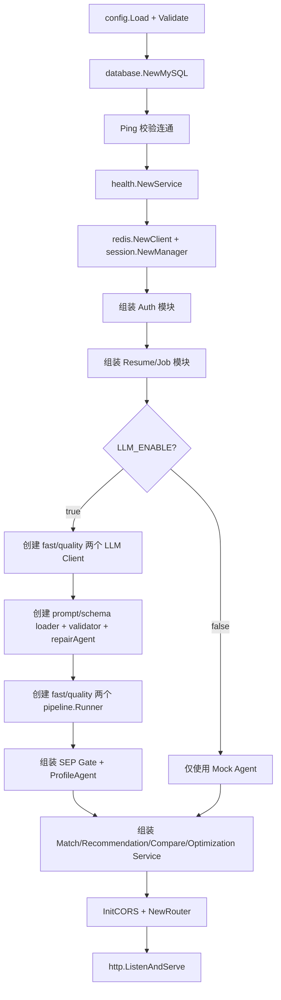

# 01 — 架构分层与组件总览

## 1. 整体组件图

```mermaid
graph TB
    %% ===== 入口层 =====
    subgraph ENTRY["入口层 cmd"]
        MAIN["cmd/server/main.go<br/><b>Composition Root</b><br/>加载配置→初始化DB/Redis→组装全部依赖→启动HTTP"]
    end

    %% ===== HTTP 层 =====
    subgraph HTTP["HTTP 层 internal/http + middleware"]
        ROUTER["router.go<br/>NewRouter(RouterDeps)<br/>路由注册 + 中间件链"]
        AUTH_H["AuthHandler"]
        RESUME_H["ResumeHandler"]
        JOB_H["JobHandler"]
        MATCH_H["MatchHandler"]
        REC_H["RecommendationHandler"]
        VC_H["VersionCompareHandler"]
        OPT_H["ResumeOptimizationHandler"]
        MW["middleware<br/>Recover → CORS → RequestLogger<br/>Auth(JWT+Redis会话)"]
    end

    %% ===== Service 层 =====
    subgraph SVC["业务层 internal/service"]
        AUTH_S["AuthService"]
        RESUME_S["ResumeService"]
        PROF_S["ResumeProfileService"]
        JOB_S["JobService"]
        MATCH_S["MatchService"]
        REC_S["RecommendationService"]
        VC_S["VersionCompareService"]
        OPT_S["ResumeOptimizationService"]
        TAG_S["TagEvidenceService"]
        SEP_S["SemanticProfileService"]
        SEP_G["SemanticProfileGate"]
        SEP_P["SemanticProfileProfiler"]
    end

    %% ===== Agent 层 =====
    subgraph AGENT["Agent 层 internal/agent"]
        BAGENT["业务 Agent<br/>MatchAnalysisAgent / RecommendationAgent /<br/>ResumeOptimizationAgent / CoreLLMAgent /<br/>ProfileAgent / VersionCompareLLMAgent"]
        DEEP["Deep 3-agent<br/>match/recommend/optimization/compare _deep_agents"]
        PIPELINE["pipeline.Runner<br/>统一 LLM 管线"]
        REPAIR["repair.Agent<br/>JSONRepairAgent"]
        GUARD["guardrail<br/>本地确定性护栏"]
        MOCK["Mock Agent（规则兜底）<br/>MatchMock / RecommendationMock /<br/>OptimizationMockV2 / VersionCompareMock"]
    end

    %% ===== LLM 层 =====
    subgraph LLM["LLM 层 internal/llm"]
        LLMIF["Client 接口"]
        HY3["Hy3Client<br/>(腾讯云 LKEAP)"]
        HUNY["HunyuanClient<br/>(OpenAI 兼容)"]
        NOOP["NoopClient"]
    end

    %% ===== 数据层 =====
    subgraph DATA["数据层 internal/repository + model + database"]
        REPO["repository<br/>User/Resume/ResumeProfile/Job/JobProfile/<br/>Match/Recommendation/Optimization/Compare/SemanticProfile"]
        MODEL["model<br/>实体 + DTO（纯类型）"]
        MYSQL["database.MySQL<br/>(*sql.DB 封装)"]
    end

    %% ===== 支撑层 =====
    subgraph INFRA["支撑层"]
        CFG["config"]
        SESS["session.Manager<br/>(Redis)"]
        SCHEMA["schema<br/>Loader/Validator"]
        PROMPT["prompt<br/>Loader"]
        LLMJSON["llmjson"]
        ERRPKG["errors.AppError"]
        RESP["response"]
        HEALTH["health.Service"]
    end

    %% ===== 外部依赖 =====
    subgraph EXT["外部依赖"]
        MYSQL_EXT[("MySQL")]
        REDIS_EXT[("Redis")]
        LLM_EXT[("LLM API<br/>Hunyuan / Hy3")]
        VITE["Vite 前端<br/>(dev 反代)"]
    end

    %% 入口组装
    MAIN --> ROUTER
    MAIN --> AUTH_S
    MAIN --> MATCH_S
    MAIN --> REC_S
    MAIN --> VC_S
    MAIN --> OPT_S
    MAIN --> PIPELINE
    MAIN --> REPAIR
    MAIN --> LLMIF
    MAIN --> REPO
    MAIN --> CFG
    MAIN --> MYSQL
    MAIN --> SESS

    %% HTTP → Service
    ROUTER --> AUTH_H & RESUME_H & JOB_H & MATCH_H & REC_H & VC_H & OPT_H
    AUTH_H --> AUTH_S
    RESUME_H --> RESUME_S & PROF_S
    JOB_H --> JOB_S
    MATCH_H --> MATCH_S
    REC_H --> REC_S
    VC_H --> VC_S
    OPT_H --> OPT_S
    ROUTER --> MW
    MW --> AUTH_S
    MW --> SESS

    %% Service → Agent / Repo / LLM
    MATCH_S --> BAGENT & DEEP & MOCK & TAG_S & SEP_S & LLMIF
    REC_S --> BAGENT & DEEP & MOCK & TAG_S & PROF_S & SEP_G & LLMIF
    VC_S --> BAGENT & DEEP & MOCK & TAG_S & PROF_S
    OPT_S --> BAGENT & DEEP & MOCK & TAG_S
    RESUME_S --> PROF_S

    %% Agent 内部
    BAGENT --> PIPELINE
    DEEP --> PIPELINE
    PIPELINE --> REPAIR
    PIPELINE --> LLMIF
    PIPELINE --> SCHEMA & PROMPT & LLMJSON
    REPAIR --> LLMIF & SCHEMA & PROMPT & LLMJSON
    DEEP --> GUARD
    MOCK --> GUARD

    %% LLM 实现
    LLMIF -.-> HY3
    LLMIF -.-> HUNY
    LLMIF -.-> NOOP

    %% SEP 链
    SEP_G --> SEP_S & SEP_P
    SEP_P --> SEP_S & LLMIF

    %% 数据层
    MATCH_S & REC_S & VC_S & OPT_S & AUTH_S & RESUME_S & JOB_S & TAG_S --> REPO
    REPO --> MODEL
    REPO --> MYSQL
    SEP_S --> REPO
    MYSQL --> MYSQL_EXT
    SESS --> REDIS_EXT
    HY3 & HUNY --> LLM_EXT
    ROUTER -.-> VITE
```

## 2. 分层依赖规则

| 层 | 包 | 依赖方向 | 说明 |
|----|----|---------|------|
| 入口 | `cmd/server` | 依赖所有内部包 | 唯一的 **Composition Root**，负责依赖注入与装配 |
| HTTP | `internal/http` | → service / middleware / response / errors / health | 只做参数解析、鉴权、调用 Service、统一响应 |
| 中间件 | `internal/middleware` | → service / session / errors / response | 跨切面：恢复、CORS、日志、JWT+会话鉴权 |
| 业务 | `internal/service` | → agent / repository / model / llm | 核心编排，不含 SQL、不拼 HTTP |
| Agent | `internal/agent` | → pipeline / repair / guardrail / model | 业务 Agent 依赖 `PipelineRunner` 接口，不直接依赖 `llm.Client` |
| Pipeline | `internal/agent/pipeline` | → llm / repair / schema / prompt / llmjson | 统一 LLM 管线 |
| LLM | `internal/llm` | → （无内部业务依赖） | Provider 抽象，最底层可替换 |
| 数据访问 | `internal/repository` | → model / database | 纯 SQL，返回 model |
| 数据模型 | `internal/model` | → （无依赖） | 纯结构体/DTO/枚举 |

**关键约束**：
- 依赖单向向下，`model`、`llm`、`errors`、`response`、`llmjson` 处于最底层，不依赖业务包。
- 业务 Agent 通过 `agent.PipelineRunner` 接口解耦 LLM 调用，真正直接持 `llm.Client` 的是 `service` 层（Deep/SEP 路径）与 `pipeline`/`repair`。
- 未发现 `repository` 反向依赖 `service` 或 `http` 的循环依赖。

## 3. 进程启动流程

**说明**：`main.go` 是超大型组合根（约 280 行），承担了全部依赖装配与后台回填任务（TagEvidence 岗位/简历画像回填 goroutine）的启动。
