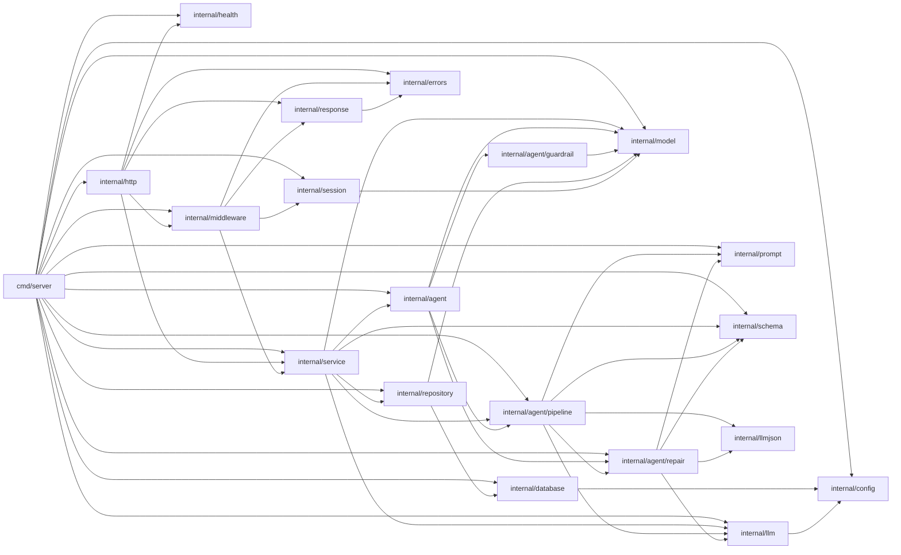
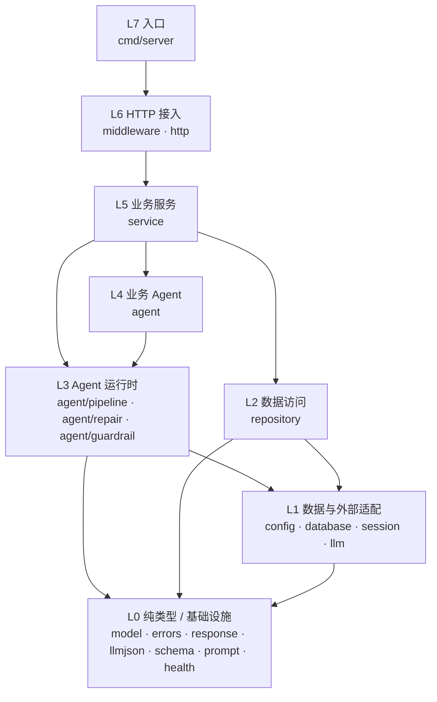

# 02 — 包依赖关系图

基于 `import` 语句静态梳理的内部包依赖关系（仅内部包，不含第三方库）。

## 1. 内部包依赖图

## 2. 依赖矩阵（关键关系）

| 源包 | 依赖的内部包 | 备注 |
|------|-------------|------|
| `cmd/server` | 几乎全部 | Composition Root，唯一允许大面积依赖 |
| `http` | errors, health, middleware, response, service | Handler 只调 Service |
| `middleware` | errors, response, service, session | Auth 中间件依赖 AuthService + Session |
| `service` | agent, llm, model, repository, pipeline, schema | 核心编排层 |
| `agent` | pipeline, repair, guardrail, model | 业务 Agent |
| `agent/pipeline` | repair, llm, llmjson, prompt, schema | 统一管线 |
| `agent/repair` | llm, llmjson, prompt, schema | JSON 修复 |
| `agent/guardrail` | model | 本地护栏，仅操作 DTO |
| `repository` | model, database | 纯 SQL 层 |
| `database` | config | MySQL 连接封装 |
| `llm` | config | LLM 配置 |
| `session` | model | Redis 会话（间接 model 常量） |
| `model` | （无） | 纯类型，零内部依赖 |
| `errors` / `response` / `llmjson` / `schema` / `prompt` / `health` | （几乎无业务依赖） | 底层基础设施 |

## 3. 依赖方向总览（分层环检测）

**结论**：依赖严格单向向下，无循环依赖。`service` 同时依赖 `agent`（L4）与 `agent/pipeline`（L3），符合"服务层编排 Agent 与管线"的设计。

## 4. 依赖健康度观察

- ✅ 未发现 `repository` → `service` 或 `http` → `repository` 的越层依赖。
- ✅ 业务 Agent 依赖 `PipelineRunner` 接口（定义于 `agent` 包），而非具体 `pipeline.Runner` 结构体，依赖倒置合理。
- ⚠️ `service` 包文件数量多（37 个），且 `match_service.go` / `recommendation_service.go` 直接持有 `llm.Client`，使 `service` 与 `llm` 强耦合（仅 Deep/SEP 路径需要，可考虑收敛到 Agent 层）。
- ⚠️ `agent` 包同时包含 `mock_helpers.go`、`agent_snapshot.go`、`compare_deep_agents.go` 等多种职责，包内聚度偏弱（详见 09-findings）。
