# 03 — 数据模型 ER 图

来源：`/workspace/server/internal/model/`（14 个非测试文件）。

## 1. 实体关系总览

```mermaid
erDiagram
    USER ||--o{ RESUME : "拥有"
    RESUME ||--o{ RESUME_EDUCATION : "包含"
    RESUME ||--o{ RESUME_PROJECT : "包含"
    RESUME ||--o{ RESUME_INTERNSHIP : "包含"
    RESUME ||--o{ RESUME_LANGUAGE_EXAM : "包含"
    RESUME ||--o{ RESUME_CERTIFICATE : "包含"
    RESUME ||--o{ RESUME_AWARD : "包含"
    RESUME ||--o{ RESUME_WORK : "包含"

    JOB ||--o{ JOB_PROFILE : "画像"

    USER ||--o{ RESUME_PROFILE : "拥有"
    RESUME ||--o{ RESUME_PROFILE : "画像"

    USER ||--o{ MATCH_ANALYSIS : "生成"
    RESUME ||--o{ MATCH_ANALYSIS : "基于"
    JOB ||--o{ MATCH_ANALYSIS : "匹配"

    USER ||--o{ RECOMMENDATION_RESULT : "生成"
    RESUME ||--o{ RECOMMENDATION_RESULT : "基于"

    USER ||--o{ RESUME_OPTIMIZATION : "生成"
    RESUME ||--o{ RESUME_OPTIMIZATION : "基于"
    JOB |o--o{ RESUME_OPTIMIZATION : "可选目标岗位"

    USER ||--o{ RESUME_COMPARE : "生成"
    RESUME ||--o{ RESUME_COMPARE : "from 版本"
    RESUME ||--o{ RESUME_COMPARE : "to 版本"

    SEMANTIC_PROFILE ||--o{ SEMANTIC_PROFILE_TAG : "包含标签"

    USER {
        uint64 ID PK
        string Email
        string Phone
        string PasswordHash
        string Name
        time CreatedAt
        time UpdatedAt
    }

    RESUME {
        uint64 ID PK
        uint64 UserID FK
        string Name
        bool IsCurrent
        string RawText
        time CreatedAt
        time UpdatedAt
    }

    JOB {
        uint64 ID PK
        string Title
        string Direction
        string Category
        string Status
        string ExternalSource
    }

    JOB_PROFILE {
        uint64 ID PK
        uint64 JobID FK
        string Direction
        string PrimaryTagsJSON
        string EvidenceJSON
    }

    RESUME_PROFILE {
        uint64 ID PK
        uint64 ResumeID FK
        uint64 UserID FK
        string ProfileType
        string Status
        string DominantProfile
        string EvidenceJSON
    }

    MATCH_ANALYSIS {
        uint64 ID PK
        uint64 UserID FK
        uint64 ResumeID FK
        uint64 JobID FK
        string GenerationTier
        string GeneratedBy
        int Score
        bytes ResultJSON
    }

    RECOMMENDATION_RESULT {
        uint64 ID PK
        uint64 UserID FK
        uint64 ResumeID FK
        string GenerationTier
        string GeneratedBy
        bytes ResultJSON
    }

    RESUME_OPTIMIZATION {
        uint64 ID PK
        uint64 UserID FK
        uint64 ResumeID FK
        uint64 JobID FK "可选，0=无岗位"
        string GenerationTier
        bytes ResultJSON
    }

    RESUME_COMPARE {
        uint64 ID PK
        uint64 UserID FK
        uint64 FromResumeID FK
        uint64 ToResumeID FK
        bytes ResultJSON
    }

    SEMANTIC_PROFILE {
        int64 ID PK
        string TargetType "resume/job"
        int64 TargetID "多态外键"
        string Status
        string ContentHash
        string ProfileJSON
    }

    SEMANTIC_PROFILE_TAG {
        int64 ID PK
        int64 ProfileID FK
        string TagCode
        float Confidence
    }
```

## 2. 核心持久化实体字段明细

> 仅列 DB 实体（非 DTO）。`JSON` 字段用 `*JSON` / `[]byte` 表示序列化存储。

### 2.1 User / Resume / Job

| 实体 | 表 | 关键字段 |
|------|----|---------|
| `User` | `users` | `ID`, `Email`, `Phone`, `PasswordHash`, `Name`, `CreatedAt`, `UpdatedAt` |
| `Resume` | `resumes` | `ID`, `UserID`→User, `Name`, `IsCurrent`, `RealName/Phone/Email/City`, `ProfessionalSkills`, `AIApplication`, `Homepage`, `AdditionalInfo`, `RawText`（AI 文本快照）, 7 个子表切片 |
| `Job` | `jobs` | `ID`, `Title/Department/City/Direction/Category/JobType`, `Summary/Description/Requirements`, 大量 `*JSON` 字段（Responsibilities/MustHave/Skills/Facets 等）, `Status`, `ExternalSource/ExternalID`, `DataQuality` |

### 2.2 Resume 子表（均 `ResumeID` → `Resume.ID`，`SortOrder` 排序）

| 子实体 | 表 | 关键字段 |
|--------|----|---------|
| `ResumeEducation` | `resume_educations` | School, Degree, Major, Department, GPA, GPAScale, RankText, CoreCourses, ResearchDirection, Advisor, Lab, PaperSummary |
| `ResumeProject` | `resume_projects` | Name, Role, StartDate, EndDate, Description |
| `ResumeInternship` | `resume_internships` | Company, Position, StartDate, EndDate, Description |
| `ResumeLanguageExam` | `resume_language_exams` | ExamType, Score |
| `ResumeCertificate` | `resume_certificates` | Name, Description |
| `ResumeAward` | `resume_awards` | Name, Description |
| `ResumeWork` | `resume_works` | Name, URL, Password |

### 2.3 画像与快照

| 实体 | 表 | 关键字段 | 说明 |
|------|----|---------|------|
| `JobProfile` | `job_profiles` | `JobID`, Direction, Category, `PrimaryTagsJSON/SkillTagsJSON/.../EvidenceJSON`, Source, Version | 岗位标签画像 |
| `ResumeProfile` | `resume_profiles` | `ResumeID`, `UserID`, `ProfileType`(fast/quality), `Status`(pending/ready/failed/stale), `DominantProfile`, `PrimaryTagsJSON/CandidateTagsJSON/RiskTagsJSON/EvidenceJSON` | 候选人画像 |
| `SemanticProfile` | `semantic_profiles` | `TargetType`(resume/job), `TargetID`(多态), `ContentHash`, `SummarySentence`, `StrengthsJSON/RisksJSON/FitDirectionsJSON/ProfileJSON`, `Status` | SEP 语义画像 |
| `SemanticProfileTag` | `semantic_profile_tags` | `ProfileID`→SemanticProfile, TagCode, TagLabel, Category, Confidence, Weight | 语义标签 |

### 2.4 结果快照实体（GenerationTier 分级产物）

| 实体 | 表 | 外键 | 说明 |
|------|----|------|------|
| `MatchAnalysis` | `match_analyses` | `UserID`+`ResumeID`+`JobID` | 岗位匹配分析快照 |
| `RecommendationResult` | `recommendation_results` | `UserID`+`ResumeID` | 岗位推荐结果快照 |
| `ResumeOptimizationSnapshot` | `resume_optimizations` | `UserID`+`ResumeID`+`JobID`(可选) | 简历优化快照 |
| `ResumeCompareResult` | `resume_compares` | `UserID`+`FromResumeID`+`ToResumeID` | V1 版本对比 |
| `ResumeCompareResultV2` | （V2 表） | `UserID`+`FromResumeID`+`ToResumeID`+`JobID`(可选) | V2 版本对比，含 `ComparisonMode` |

## 3. 关键关系说明

1. **多态外键**：`SemanticProfile.TargetType + TargetID` 同时指向 `Resume` 或 `Job`，非强类型 FK，由 `TargetType` 区分。
2. **Result 快照模式**：Match/Recommendation/Optimization/Compare 均以 `ResultJSON []byte` 存完整结果，外层列冗余 `GenerationTier/GeneratedBy/Status/ProfileType/ProfileDominantProfile` 用于快速筛选与最新结果查询（`FindLatestByXxx`）。
3. **画像三套并存**：`ResumeProfile`（规则+LLM 画像）、`JobProfile`（岗位标签）、`SemanticProfile`（SEP 语义画像），三者服务于 fast 与 quality 两条生成链路。
4. **DTO 与实体分离**：`MatchAnalysisResult`、`RecommendedJob`、`ResumeOptimizationResult`、`CompareResponseV2` 等为 API 返回 DTO，携带 `JobID/ResumeID` 标识但非独立表。

## 4. 枚举 / 常量速查

| 维度 | 取值 |
|------|------|
| GenerationTier | `fast` / `quality`（`deep` 归一化为 `quality`） |
| ProfileType | `fast` / `quality` |
| ProfileStatus | `pending` / `ready` / `failed` / `stale` |
| SemanticProfile.Status | `pending` / `processing` / `verified` / `failed` / `stale` |
| DominantProfile | `algorithm_research` / `backend_engineering` / `product_operation` / `business_solution` / `career_exploration` |
| AgentStatus | `success` / `repaired` / `fallback` / `mock_success` / `error` / `verified` 等 |
| GeneratedBy | `llm_agent` / `mock_agent` / `fallback_agent` / `fast_tag_engine` 等 |
