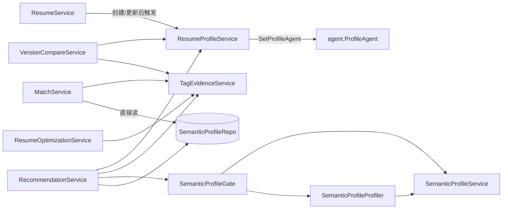

# 04 — Service 业务层类图

来源：`/workspace/server/internal/service/`（37 个文件，其中 10 个核心 Service + 引擎/工具文件）。

## 1. Service 类图总览

```mermaid
classDiagram
    class AuthService {
        -userRepo *repository.UserRepository
        -sessionMgr *session.Manager
        -jwtSecret string
        -jwtExpireHours int
        +Register(ctx, req) 
        +Login(ctx, req)
        +ParseToken(token) (userID, sessionID, err)
        +ValidateSession(ctx, userID, sessionID)
        +Logout(ctx, userID, sessionID)
    }

    class ResumeService {
        -resumeRepo *repository.ResumeRepository
        -profileService *ResumeProfileService
        +List/GetCurrent/GetDetail
        +Create/Update/Delete
        +SetCurrent
        +SetProfileService(svc)
    }

    class ResumeProfileService {
        -resumeRepo *repository.ResumeRepository
        -profileRepo *repository.ResumeProfileRepository
        -profileAgent *agent.ProfileAgent
        +EnsureProfile
        +GetProfileStatus
        +SetProfileAgent(agent)
    }

    class JobService {
        -jobRepo *repository.JobRepository
        +List/Detail
        +FacetsV2
    }

    class MatchService {
        -resumeRepo
        -jobRepo
        -matchRepo
        -mockAgent *agent.MatchMockAgent
        -fastRunner PipelineRunner
        -qualityRunner PipelineRunner
        -llmEnabled bool
        -fallbackEnable bool
        -enableMockAgent bool
        -tagEvidence *TagEvidenceService
        -semanticRepo *repository.SemanticProfileRepository
        -hy3Client llm.Client
        +Analyze(ctx, ...)
        +Latest(ctx, ...)
    }

    class RecommendationService {
        -resumeRepo
        -jobRepo
        -recommendationRepo
        -mockAgent
        -fastRunner
        -qualityRunner
        -profileSvc *ResumeProfileService
        -tagEvidence *TagEvidenceService
        -semanticGate *SemanticProfileGate
        -semanticRepo
        -qualityClient llm.Client
        -qualityModel string
        +Recommend(ctx, ...)
        +Latest(ctx, ...)
    }

    class VersionCompareService {
        -resumeRepo
        -compareRepo
        -jobRepo
        -mockAgent
        -fastRunner
        -qualityRunner
        -profileSvc
        -tagEvidence
        +CompareV2
        +LatestV2
    }

    class ResumeOptimizationService {
        -resumeRepo
        -jobRepo
        -optimizationRepo
        -mockAgent interface{}
        -fastRunner
        -qualityRunner
        -tagEvidence
        +OptimizeV2
        +LatestV2
    }

    class TagEvidenceService {
        -resumeRepo
        -profileRepo
        -jobProfileRepo
        -jobRepo
        +EnsureResumeTagProfile
        +EnsureAllOpenJobTagProfiles
        +RecallCandidates
        +SetJobRepo(repo)
    }

    class SemanticProfileService {
        -db *sql.DB
        -semanticRepo
        -resumeRepo
        -jobRepo
        +GetOrCreatePending
        +SaveVerified
        +ContentHash
    }

    class SemanticProfileGate {
        -service *SemanticProfileService
        -profiler *SemanticProfileProfiler
        +EnsureResumeProfileAsync
        +EnsureJobProfileAsync
    }

    class SemanticProfileProfiler {
        -semanticService
        -resumeRepo
        -jobRepo
        -llmClient llm.Client
        -qualityModel string
        +ProfileResume
        +ProfileJob
    }

    class SemanticProfileBackfillService {
        -gate *SemanticProfileGate
        -semanticRepo
        -resumeRepo
        -jobRepo
        +BackfillMissing
    }

    %% 依赖关系（构造函数注入）
    AuthService ..> session.Manager
    AuthService ..> repository.UserRepository

    ResumeService ..> ResumeProfileService : SetProfileService

    MatchService ..> TagEvidenceService
    MatchService ..> repository.SemanticProfileRepository
    MatchService ..> llm.Client

    RecommendationService ..> ResumeProfileService
    RecommendationService ..> TagEvidenceService
    RecommendationService ..> SemanticProfileGate
    RecommendationService ..> repository.SemanticProfileRepository
    RecommendationService ..> llm.Client

    VersionCompareService ..> ResumeProfileService
    VersionCompareService ..> TagEvidenceService

    ResumeOptimizationService ..> TagEvidenceService

    SemanticProfileGate ..> SemanticProfileService
    SemanticProfileGate ..> SemanticProfileProfiler
    SemanticProfileProfiler ..> SemanticProfileService
    SemanticProfileProfiler ..> llm.Client
    SemanticProfileBackfillService ..> SemanticProfileGate
```

## 2. Service 依赖矩阵（谁注入了谁）

| Service | Repository | Agent | LLM | 其他 Service |
|---------|-----------|-------|-----|-------------|
| AuthService | UserRepository | — | — | session.Manager |
| ResumeService | ResumeRepository | — | — | ResumeProfileService |
| ResumeProfileService | ResumeRepository, ResumeProfileRepository | ProfileAgent | — | — |
| JobService | JobRepository | — | — | — |
| MatchService | Resume/Job/Match/SemanticProfile | MatchMockAgent, fast/quality Runner | hy3Client | TagEvidenceService |
| RecommendationService | Resume/Job/Recommendation/SemanticProfile | RecommendationMockAgent, Runner | qualityClient | ResumeProfileService, TagEvidenceService, SemanticProfileGate |
| VersionCompareService | Resume/Job/Compare | VersionCompareMockAgent, Runner | — | ResumeProfileService, TagEvidenceService |
| ResumeOptimizationService | Resume/Job/Optimization | OptimizationMockV2, Runner | — | TagEvidenceService |
| TagEvidenceService | Resume/ResumeProfile/JobProfile(+Job) | — | — | — |
| SemanticProfileService | SemanticProfile/Resume/Job | — | — | — |
| SemanticProfileGate | — | — | — | SemanticProfileService, Profiler |
| SemanticProfileProfiler | Resume/Job | — | llmClient | SemanticProfileService |
| SemanticProfileBackfillService | SemanticProfile/Resume/Job | — | — | SemanticProfileGate |

## 3. Service 间调用关系图



**关键观察**：
- `TagEvidenceService` 是 Fast/Deep 兜底路径的共享引擎，被 Match/Recommendation/Optimization/VersionCompare 四个 Service 注入。
- SEP（语义画像）能力**完整接入**了 `RecommendationService`（Gate + Repo 都有），但 `MatchService` **只注入 Repo、未注入 Gate**——Match 的 SEP 画像读取走 Repository 直读，画像生成依赖外部回填（`SemanticProfileBackfillService` / 后台任务）。
- `MatchService` 与 `RecommendationService` 是唯一直接持有 `llm.Client` 的 Service（跑 Deep 5 模块 / DeepCascade 级联）。

## 4. 引擎 / 工具文件（无独立 Service 构造器）

| 文件 | 职责 |
|------|------|
| `match_sep_engine.go` | Fast Match SEP 引擎：方向适配、硬门禁、需求覆盖、证据映射、风险检测、评分校准 |
| `fast_recommend_sep_ranker.go` | Fast 推荐 SEP 语义匹配、方向门禁、打分排序 |
| `fast_recommend_explainer.go` | Fast 推荐可解释性：tag→中文解释、亮点/风险文案 |
| `match_deep_agent.go` | Quality/Deep Match 5 模块 Hy3 + 本地裁判管线（MatchService 方法） |
| `recommend_deep_cascade.go` | 深度推荐级联 `RunDeepRecommendationCascade` |
| `resume_snapshot_normalizer.go` | V1/V2 简历统一归一化为 `ResumeSnapshotV2` |
| `agent_snapshot_helper.go` | 快照转 LLM prompt JSON 共享工具 |
