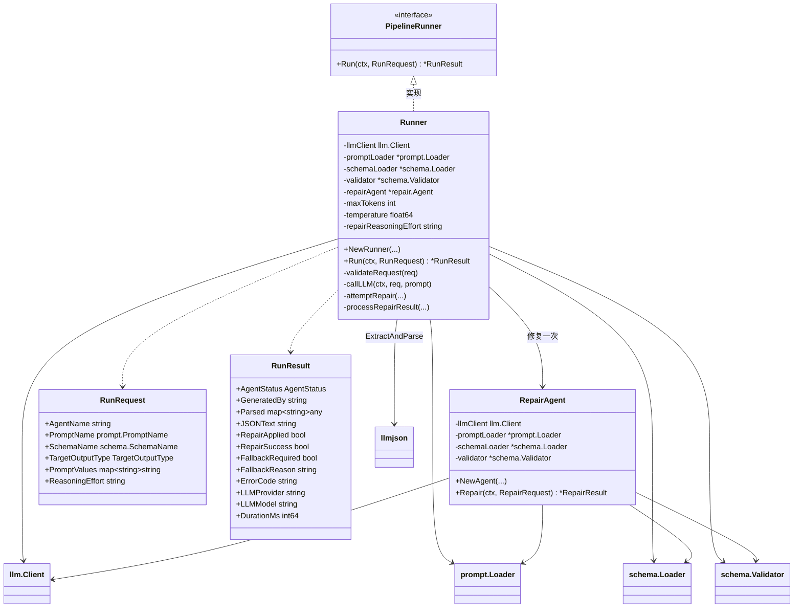
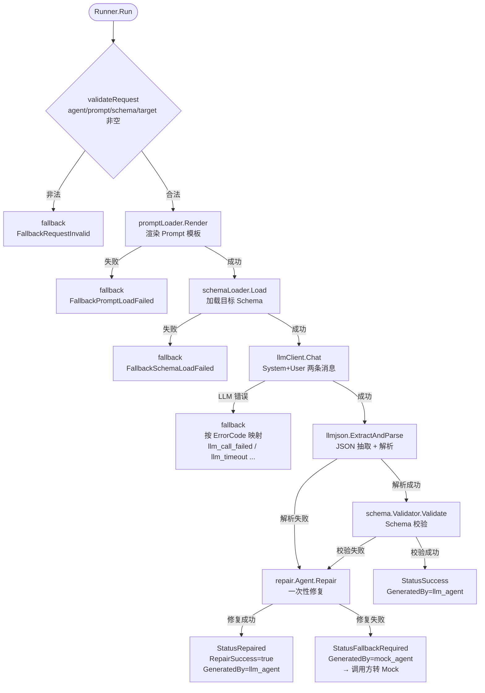
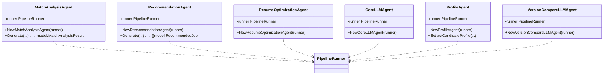
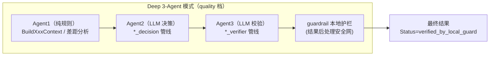
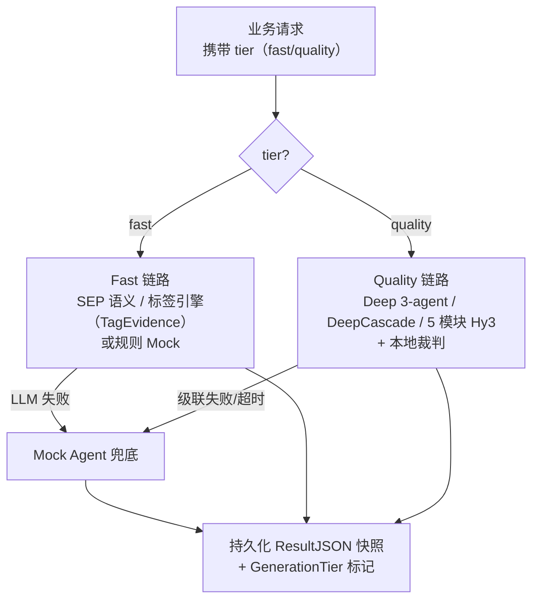

# 05 — Agent / Pipeline / Repair / Guardrail 层

来源：`/workspace/server/internal/agent/`（含 `pipeline/`、`repair/`、`guardrail/` 子包）。

## 1. Pipeline 运行时类图

## 2. Pipeline 运行流程（统一 LLM 管线）

**核心设计**：
- 管线顺序固定：`Prompt 渲染 → LLM 调用 → JSON 抽取/解析 → Schema 校验 → 失败修复一次 → 兜底`。
- 修复**恰好一次**，无递归、无重试循环。
- `RunResult.AgentStatus` 三态：`success` / `repaired` / `fallback_required`。
- `GeneratedBy`：成功/修复 = `llm_agent`；兜底 = `mock_agent`（由调用方 Service 决定是否切 Mock）。

## 3. TargetOutputType / Schema / Prompt 映射

| TargetOutputType | SchemaName | 用途 |
|------------------|-----------|------|
| `match_analysis` | `match_analysis` | 匹配分析 |
| `recommendation` | `recommendation` | 岗位推荐 |
| `resume_optimization` | `resume_optimization` | 简历优化 |
| `resume_optimization_core` | `resume_optimization_core` | Core 优化 |
| `version_compare` | `version_compare` | 版本对比 |
| `*_decision` / `*_verifier` | 对应 `*_decision` / `*_verifier` | Deep 3-agent 的 Agent2（决策）/ Agent3（校验） |

> `prompt` 包与 `schema` 包各自维护 `PromptName` / `SchemaName` 到文件名的映射，`pipeline` 通过 `TargetOutputType` 桥接两者。

## 4. 业务 Agent 类图

**说明**：所有业务 Agent 统一依赖 `PipelineRunner` 接口（在 `match_agent.go` 中定义），**不直接依赖 `llm.Client`**。LLM 调用被封装在 `pipeline.Runner` 内部。

## 5. Deep 3-agent 结构（quality 档）

| 业务域 | Agent1（规则上下文） | Agent2（LLM 决策） | Agent3（LLM 校验） | 文件 |
|--------|---------------------|-------------------|-------------------|------|
| 匹配 | `BuildMatchContext` | `match_decision` | `match_verifier` | `match_deep_agents.go` |
| 推荐 | 候选池构建 | `recommendation_decision` | `recommendation_verifier` | `recommend_deep_agents.go` |
| 优化 | 差距分析 | `optimization_decision` | `optimization_verifier` | `optimization_deep_agents.go` |
| 对比 | 规则 diff | `compare_decision` | `compare_verifier` | `compare_deep_agents.go` |

> `guardrail` 是**本地确定性护栏**，作为 Agent3 的兜底安全网与结果后处理，**补充但不替代** LLM Verifier。提供 `NormalizeScore`、`ValidateScoreDistribution`、`ValidateWinnerID`、`NormalizeMeta` 等纯函数。

## 6. Mock Agent（规则兜底）

| Mock | 构造 | 职责 |
|------|------|------|
| `MatchMockAgent` | `NewMatchMockAgent()` | 规则生成匹配分析（`AnalyzeFast`/`AnalyzeQuality`） |
| `RecommendationMockAgent` | `NewRecommendationMockAgent()` | 规则岗位推荐（标签抽取/打分/理由） |
| `ResumeOptimizationMockAgent` | `NewResumeOptimizationMockAgent()` | V1 规则优化建议 |
| `ResumeOptimizationMockAgentV2` | `NewResumeOptimizationMockAgentV2()` | 三模式（general/target_direction/target_job）规则优化，可注入 ProfileProvider 与 MatchLatestProvider |
| `VersionCompareMockAgent` | `NewVersionCompareMockAgent()` | 规则版本对比 |
| `CoreMockAgent` | `NewCoreMockAgent()` | Core 模式纯规则兜底 |

**共同点**：全部纯规则实现，不调用 LLM/Pipeline；部分可选注入 `ProfileProvider` 复用画像数据。

## 7. Fast vs Quality 生成链路

