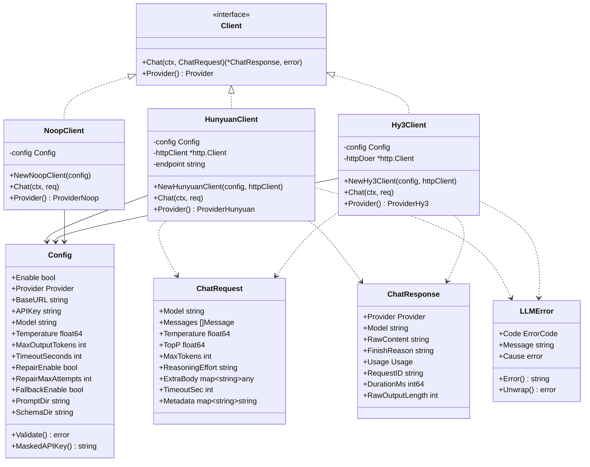
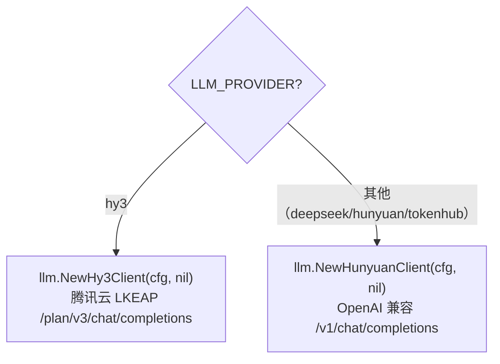
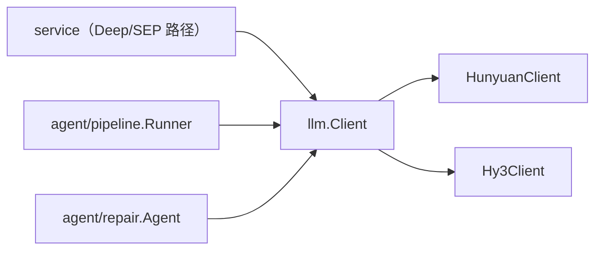

# 06 — LLM 客户端层类图

来源：`/workspace/server/internal/llm/`（13 个文件）。

## 1. LLM 层类图

## 2. Provider 工厂（main.go 中的 `newLLMClient`）

| Provider 常量 | 值 | 说明 |
|--------------|-----|------|
| `ProviderHunyuan` | `"hunyuan"` | 混元 / TokenHub / DeepSeek（OpenAI 兼容） |
| `ProviderHy3` | `"hy3"` | 腾讯云 LKEAP `hy3-preview` |
| `ProviderNoop` | `"noop"` | 测试用非网络实现 |

## 3. Provider 差异对比

| 维度 | HunyuanClient | Hy3Client |
|------|--------------|-----------|
| 端点 | `normalizeEndpoint` 归一化为 `/v1/chat/completions` | `/plan/v3/chat/completions`（LKEAP） |
| ReasoningEffort | 忽略 | 写入 `extra_body.chat_template_kwargs.reasoning_effort` |
| TopP | 未单独传（OpenAI 兼容体可带） | 支持 `top_p` |
| 错误分类 | 401/403→`LLM_AUTH_FAILED`，429→`LLM_RATE_LIMIT`，5xx→`LLM_HTTP_ERROR` | 同左，`errorFromHTTPStatus` |
| 响应体上限 | 无显式截断 | `io.LimitReader` 1MB |

## 4. ErrorCode 枚举

| ErrorCode | 触发场景 |
|-----------|---------|
| `LLM_DISABLED` | `LLM_ENABLE=false` |
| `LLM_CONFIG_MISSING` | 必填配置缺失 |
| `LLM_API_KEY_MISSING` | API key 为空 |
| `LLM_AUTH_FAILED` | HTTP 401/403（key 无效/不匹配平台） |
| `LLM_TIMEOUT` | 超时 / 取消 |
| `LLM_HTTP_ERROR` | 网络错误 / 5xx |
| `LLM_RATE_LIMIT` | HTTP 429 |
| `LLM_EMPTY_RESPONSE` | 空内容 |
| `LLM_OUTPUT_TRUNCATED` | `finish_reason=length` |
| `UNKNOWN_ERROR` | 未分类 |

**兜底决策辅助**：`llm.IsDirectMockFallback(err)` 判断是否**直接转 Mock**（配置/鉴权/超时/限流/空响应/未知），跳过 JSON 修复。这被 Pipeline 用于决定是走 `attemptRepair` 还是立即 `fallback`。

## 5. 安全设计

- `ChatRequest.Metadata` / `ChatResponse` 明确约束：**绝不携带 API key**。
- `LLMError` 不变量：**绝不包含 API key、完整 Prompt、完整简历、完整 JD**。
- `Config.APIKey` JSON tag 为 `-`（不序列化），`MaskedAPIKey()` 用于日志脱敏。
- Pipeline / Repair 层的 `safeErr` / `redactSensitive` 二次脱敏（`sk-`、`key=`、`token=` 等模式）。

## 6. 与上层的耦合

- `pipeline.Runner` / `repair.Agent` 通过 `llm.Client` 接口调用，是最核心的 LLM 消费方。
- `service` 层仅有 `MatchService`、`RecommendationService`、`SemanticProfileProfiler` 直接持有 `llm.Client`（跑 Deep 5 模块 / DeepCascade / SEP 画像生成）。
- 业务 Agent 不依赖 `llm.Client`（依赖 `PipelineRunner`）。
