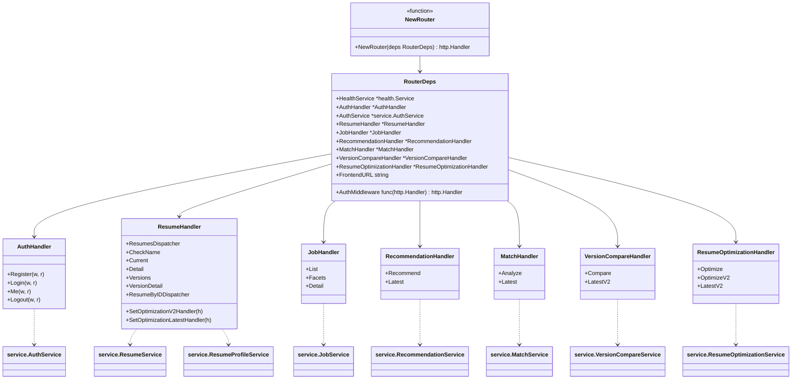
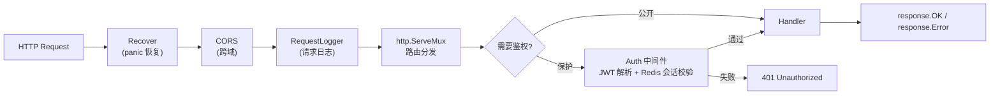

# 07 — HTTP 路由 / Handler / 中间件层

来源：`/workspace/server/internal/http/`、`/workspace/server/internal/middleware/`。

## 1. Router 与 Handler 类图



## 2. 中间件链



**中间件装配顺序**（`router.go`，外层先执行）：
```go
handler := middleware.RequestLogger(mux)
handler = middleware.CORS(handler)
handler = middleware.Recover(handler)
// 实际执行：Recover → CORS → RequestLogger → mux
```

**Auth 中间件流程**（`middleware/auth.go`）：
1. 解析 `Authorization: Bearer <token>`。
2. `authService.ParseToken` → 得到 `userID` + `sessionID`。
3. `authService.ValidateSession` → 校验 Redis 会话 + 当前会话指针（`ErrSessionReplaced` 区分顶替）。
4. 通过后注入 `user_id` / `session_id` 到 context，供 Handler 通过 `middleware.UserIDFromContext` 读取。

## 3. 路由表

### 公开路由（无需鉴权）

| Method | 路径 | Handler |
|--------|------|---------|
| GET | `/healthz` | `healthzHandler` |
| POST | `/api/auth/register` | `AuthHandler.Register` |
| POST | `/api/auth/login` | `AuthHandler.Login` |
| GET | `/api/jobs` | `JobHandler.List` |
| GET | `/api/jobs/facets` | `JobHandler.Facets` |
| GET | `/api/jobs/{id}` | `JobHandler.Detail`（经由 `dispatchJobWildcard`） |
| GET | `/swagger/doc.json` | 静态 `docs/swagger.json` |
| GET | `/swagger/` | 内置 Swagger UI |

### 保护路由（`AuthMiddleware` 包裹）

| Method | 路径 | Handler |
|--------|------|---------|
| GET | `/api/auth/me` | `AuthHandler.Me` |
| POST | `/api/auth/logout` | `AuthHandler.Logout` |
| GET/POST | `/api/resumes` | `ResumeHandler.ResumesDispatcher` |
| GET | `/api/resumes/check-name` | `ResumeHandler.CheckName` |
| GET | `/api/resumes/current` | `ResumeHandler.Current` |
| GET | `/api/resumes/detail` | `ResumeHandler.Detail` |
| GET | `/api/resumes/versions` | `ResumeHandler.Versions` |
| GET/POST | `/api/resumes/versions/compare` | `VersionCompareHandler.Compare` |
| GET | `/api/resumes/compare/latest` | `VersionCompareHandler.LatestV2` |
| GET/POST | `/api/resumes/compare` | `VersionCompareHandler.Compare` |
| GET | `/api/resumes/versions/{id}` | `ResumeHandler.VersionDetail` |
| POST | `/api/resumes/optimize` | `ResumeOptimizationHandler.Optimize` |
| 任意 | `/api/resumes/{id}/...` | `ResumeHandler.ResumeByIDDispatcher`（含 V2 优化） |
| POST | `/api/jobs/recommend` | `RecommendationHandler.Recommend` |
| GET | `/api/jobs/recommend/latest` | `RecommendationHandler.Latest` |

### 内联鉴权路由（`dispatchJobWildcard` 内部手动鉴权）

| Method | 路径 | Handler |
|--------|------|---------|
| POST | `/api/jobs/{id}/match` | `MatchHandler.Analyze` |
| GET | `/api/jobs/{id}/match/latest` | `MatchHandler.Latest` |

> `dispatchJobWildcard` 对 `/api/jobs/{id}/match` 不走 `AuthMiddleware`，而是**内联**解析 Bearer token → 校验会话 → 注入 `userID`+`jobID` 到 context，再调用 `MatchHandler`。

## 4. 路由注册注意事项

1. **固定路径先于通配符**：`/api/resumes/check-name`、`/api/resumes/current` 等在 `/api/resumes/` 通配符之前注册；`/api/jobs/recommend` 在 `/api/jobs/` 通配符之前注册。
2. **Dispatcher 模式**：`ResumesDispatcher` 按 HTTP Method 分发 GET(列表)/POST(创建)；`ResumeByIDDispatcher` 按子路径分发 `/set-current`、`/optimization` 等。
3. **前端反代**：非 API 请求通过 `newFrontendProxy` 反代到 Vite dev server（`FRONTEND_URL`），并处理 HMR WebSocket 升级。

## 5. 统一响应与错误

```mermaid
classDiagram
    class Response {
        +Code int
        +Message string
        +Data interface{}
    }
    class response {
        <<package>>
        +OK(w, data)
        +OKWithMessage(w, msg, data)
        +Error(w, status, code, msg)
        +WriteAppError(w, err)
    }
    class AppError {
        +Code int
        +Message string
        +HTTPStatus int
        +Err error
        +AsAppError(err) *AppError
    }
    Response <.. response
    response ..> AppError
```

- 所有响应统一 `{code, message, data}` 结构。
- 错误码分段：`400xx` 通用、`410xx` Auth、`420xx` Resume、`430xx` Job。
- `response.WriteAppError` 自动从 `*AppError` 提取状态码/业务码/消息，非 `AppError` 回退 `50000`。
